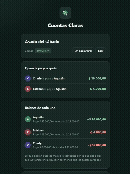
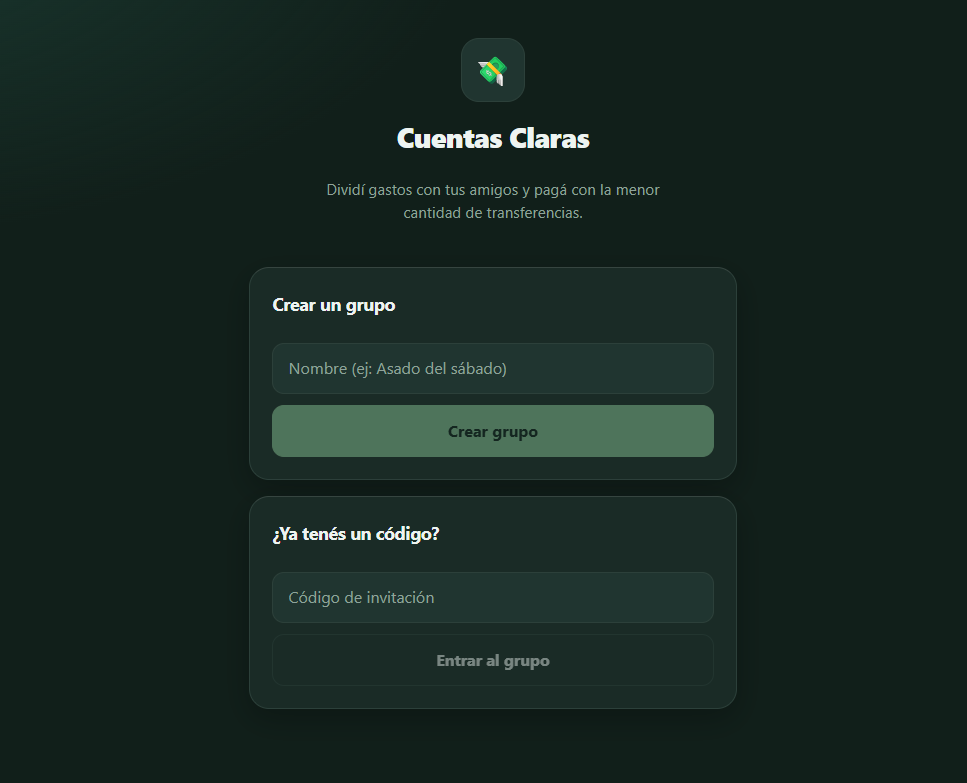
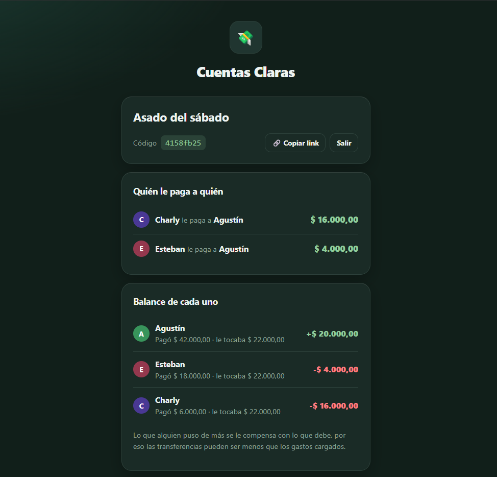
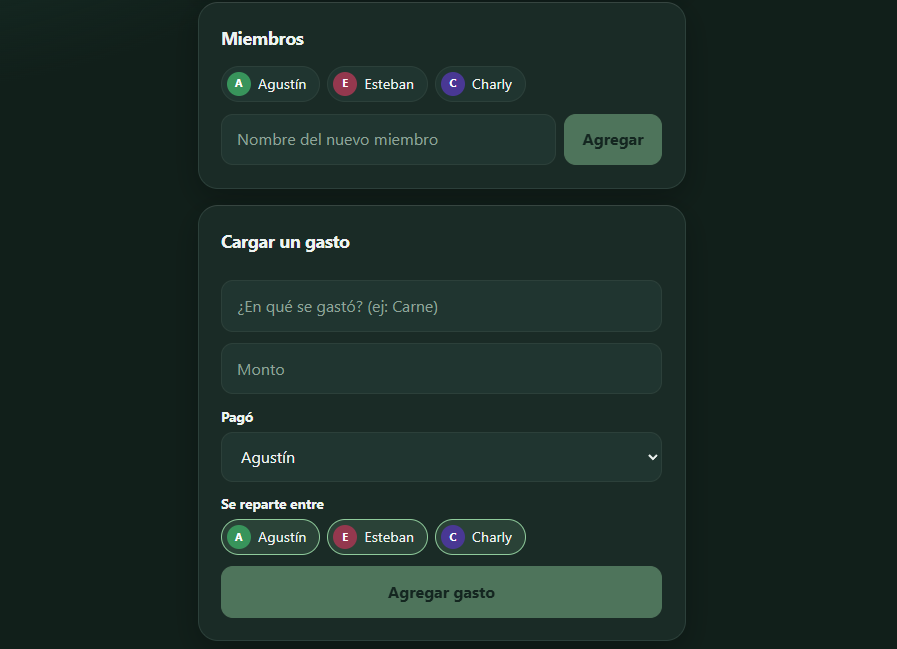
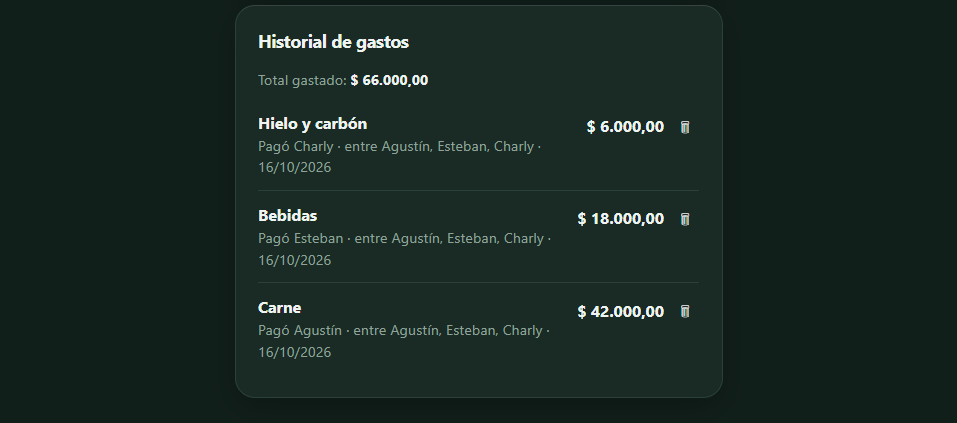

# 💸 Cuentas Claras

Dividí gastos con tus amigos y sabé quién le paga a quién, con la menor cantidad de transferencias posibles.


<p align="center">
  
</p>

🔗 **[Probalo online](https://cuentas-claras-alpha-rosy.vercel.app/#/demo)**

> La demo corre en planes gratuitos: el servidor se duerme por inactividad, así que la primera carga puede tardar hasta un minuto, y los datos pueden reiniciarse.

## ✨ Funcionalidades

- **Grupos con link de invitación**: sin registro, cualquiera con el link entra al grupo.
- **Gastos repartidos a medida**: elegís quién pagó y entre quiénes se reparte (no hace falta que participen todos), en partes iguales, por porcentaje o con montos fijos.
- **Pesos y dólares**: cada gasto se carga en su moneda y los balances y deudas se calculan por separado (no se convierten entre sí).
- **Balance por persona**: cuánto puso cada uno, cuánto le tocaba y su saldo.
- **Simplificación de deudas**: el algoritmo compensa lo que se debe entre sí y devuelve la menor cantidad de transferencias.
- **Historial de gastos** con opción de borrar, y las deudas se recalculan al instante.
- **Resumen para WhatsApp**: un botón arma el texto con las deudas y los balances para mandarlo al grupo.
- **Instalable como PWA**: se agrega a la pantalla de inicio y abre sin conexión (la app queda cacheada).
- **Gráficos de gastos**: compara lo que puso cada persona con lo que le tocaba.
- **Diseño mobile-first** con tema oscuro.

<p align="center">
  
  
</p>
<p align="center">
  
  
</p>

## 🧠 Cómo funciona la simplificación de deudas

Un ejemplo con el grupo de demo, donde cada gasto se reparte entre Agustín, Esteban y Charly:

| Gasto | Lo pagó |
|---|---|
| Carne ($42.000) | Agustín |
| Bebidas ($18.000) | Esteban |
| Hielo y carbón ($6.000) | Charly |

A cada uno le tocan $22.000. Se calcula el saldo de cada persona (lo que pagó menos lo que le tocaba):

| | Pagó | Le tocaba | Saldo |
|---|---|---|---|
| Agustín | $42.000 | $22.000 | **+$20.000** |
| Esteban | $18.000 | $22.000 | **-$4.000** |
| Charly | $6.000 | $22.000 | **-$16.000** |

Después se cruza al mayor deudor con el mayor acreedor hasta dejar todo en cero:

1. **Charly → Agustín: $16.000**
2. **Esteban → Agustín: $4.000**

Sin compensar, Esteban le tendría que haber pagado $14.000 a Agustín por la carne. Como él puso $18.000 en bebidas, termina pagando solo $4.000. La lógica está en [`SimplificadorDeDeudas.cs`](backend/CuentasClaras.Core/Services/SimplificadorDeDeudas.cs) y cubierta con tests.

El reparto trabaja con centavos: si un monto no se divide exacto entre los participantes, el centavo sobrante se asigna a uno de ellos para que la suma siempre cierre.

Los gastos pueden cargarse en pesos o en dólares. Cada moneda se compensa por separado: nunca se suman ni se convierten automáticamente, así que un grupo puede tener deudas en ambas monedas a la vez.

## 🛠 Stack

- **Backend**: ASP.NET Core (.NET 10), Entity Framework Core, SQLite
- **Frontend**: React, TypeScript, Vite
- **App Android**: Capacitor (el mismo frontend empaquetado como APK)
- **Tests**: xUnit

## 📁 Estructura

```
cuentas-claras/
├── backend/
│   ├── CuentasClaras.Api/     # controllers y configuración
│   ├── CuentasClaras.Core/    # entidades y algoritmo de deudas
│   ├── CuentasClaras.Infra/   # EF Core y migraciones
│   └── CuentasClaras.Tests/   # xUnit
├── frontend/                  # React + TypeScript
└── docs/                      # capturas y GIF
```

La lógica de negocio vive en `Core` y no depende de nada, por eso se testea sin base de datos.

## 🚀 Cómo correrlo

Necesitás [.NET SDK](https://dotnet.microsoft.com/download) y [Node.js](https://nodejs.org).

```bash
git clone https://github.com/0lypus/cuentas-claras.git
cd cuentas-claras
```

**Backend** (crea la base SQLite automáticamente en el primer arranque):

```bash
cd backend
dotnet run --project CuentasClaras.Api
```

**Frontend** (en otra terminal):

```bash
cd frontend
npm install
npm run dev
```

Abrí `http://localhost:5173`. La API escucha en `http://localhost:5140`.

## 📱 App Android (APK)

El APK empaqueta el mismo frontend con [Capacitor](https://capacitorjs.com) y consume la API configurada en `frontend/.env.production`.

Necesitás **JDK 21** y el **Android SDK** (platform 36). Después:

```bash
cd frontend
npm install
npm run android:apk
```

El APK de debug queda en `frontend/android/app/build/outputs/apk/debug/app-debug.apk` y se instala en el celular habilitando “Instalar apps desconocidas”.

Para abrirlo en Android Studio: `npm run android:open`. Si cambiás la URL de la API, editá `frontend/.env.production` y volvé a generar el APK.

> La API tiene que permitir el origen del APK (`https://localhost` y `capacitor://localhost`); el backend ya los incluye por defecto.

## 📦 Releases

En [Releases](https://github.com/0lypus/cuentas-claras/releases) se publican los binarios listos para usar:

- **`CuentasClaras-1.0.apk`**: la app para Android. Se instala en el celular habilitando “Instalar apps desconocidas”.
- **`CuentasClaras.Api.exe`**: el backend para Windows, autocontenido (no hace falta instalar .NET). Doble clic y queda escuchando en `http://localhost:5000`; la base SQLite se crea al lado del ejecutable.

## ☁️ Deploy

- **Backend (Render)**: el servicio construye con **Root Directory: `backend`** (de ahí toma el `Dockerfile` que copia todo el proyecto).
  - `DB_PATH` (opcional): ruta del archivo SQLite. Para no perder los grupos en cada deploy hay que montar un **disco persistente** en `/data` y definir `DB_PATH=/data/cuentasclaras.db`; sin disco, la base se recrea vacía en cada deploy.
  - `Cors__Origins`: orígenes permitidos separados por coma (por ejemplo la URL de Vercel).
- **Frontend (Vercel)**: build de `frontend` con `VITE_API_URL` apuntando a la API.

## 🧪 Tests

```bash
cd backend
dotnet test
```

## 🗺 Roadmap

- [x] Grupos con link de invitación
- [x] Gastos repartidos entre quienes participaron
- [x] Balance por persona y simplificación de deudas
- [x] Historial y borrado de gastos
- [x] Reparto por porcentaje o por ítem
- [x] Gastos en pesos y dólares
- [x] Resumen listo para compartir por WhatsApp
- [x] Instalable como PWA
- [x] Gráficos de gastos
- [x] Demo online

## 📄 Licencia

MIT